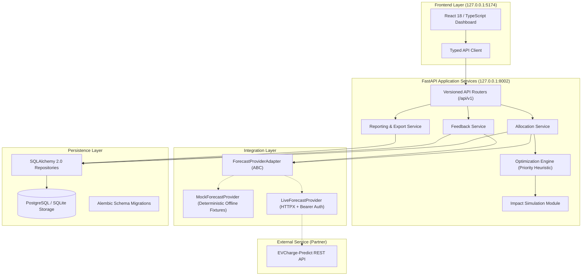
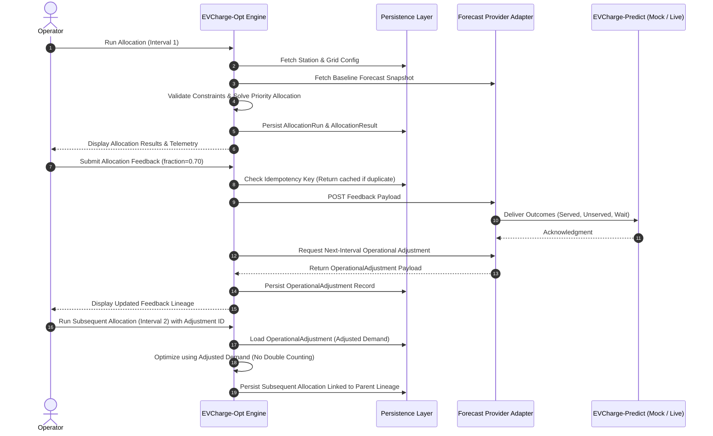
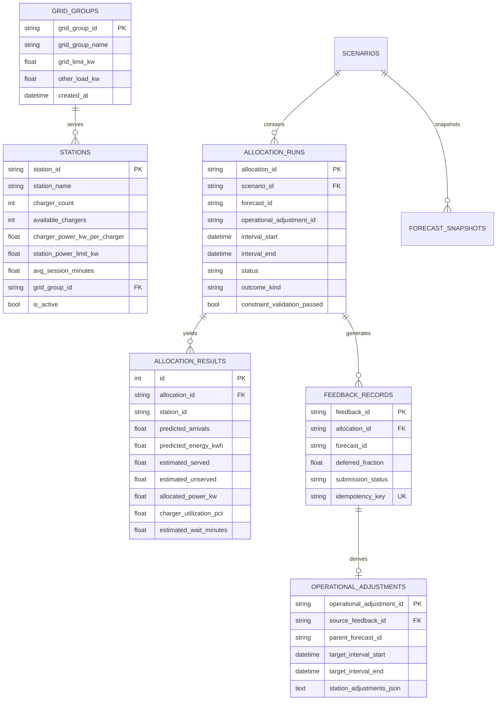

# EVCharge-Opt System Architecture & Technical Specification

## 1. Executive Summary

**EVCharge-Opt** (Intelligent EV Charging Allocation and Optimization System) is designed to operate in tandem with an external prediction service (**EVCharge-Predict**). It receives 6-interval charging demand forecasts (arrival counts and cumulative energy requirements in kWh), validates station hardware limits and shared electrical grid capacities, determines deterministic resource allocations, estimates service quality and queue delays, and generates feedback records that produce downstream operational adjustments for subsequent planning horizons.

---

## 2. Logical Architecture

---

## 3. Mathematical & Optimization Formulation

### 3.1 Hard Constraints

For each station $s \in \mathcal{S}$ and shared grid group $g \in \mathcal{G}$, let:
- $C_s$: installed chargers ($C_s \ge 1$)
- $A_s$: available operational chargers ($0 \le A_s \le C_s$)
- $P_s^{\text{rate}}$: rated power per charger ($kW$)
- $P_s^{\text{limit}}$: station service entrance limit ($kW$)
- $P_s^{\text{alloc}}$: power allocated to station $s$ ($kW$)
- $L_g^{\text{limit}}$: total grid feeder capacity ($kW$)
- $L_g^{\text{base}}$: baseline non-EV electrical load ($kW$)
- $\Delta t$: planning interval duration in hours ($\Delta t = \text{interval\_minutes} / 60.0$)

**Mandatory Feasibility Constraints:**
1. Non-negativity:
   $$P_s^{\text{alloc}} \ge 0, \quad \forall s \in \mathcal{S}$$
2. Inactive Stations:
   $$P_s^{\text{alloc}} = 0, \quad \text{if } s \text{ is inactive or } A_s = 0$$
3. Station Physical Power Cap:
   $$P_s^{\text{alloc}} \le \min\left(P_s^{\text{limit}}, A_s \times P_s^{\text{rate}}\right), \quad \forall s \in \mathcal{S}$$
4. Shared Substation Residual Grid Feeder Limit:
   $$\sum_{s \in \mathcal{S}_g} P_s^{\text{alloc}} \le \max\left(0, L_g^{\text{limit}} - L_g^{\text{base}}\right), \quad \forall g \in \mathcal{G}$$

### 3.2 Turnover & Feasible Served Vehicles

Let:
- $D_s^{\text{arrivals}}$: forecasted or adjusted arrival vehicles.
- $D_s^{\text{energy}}$: forecasted energy demand ($kWh$).
- $\tau_s$: average charging session duration in minutes.

The physical vehicle turnover capacity of the station over interval $\Delta t$ is:
$$\text{Cap}_s^{\text{phys}} = A_s \times \left(\frac{\Delta t \times 60}{\tau_s}\right)$$

The maximum vehicle throughput enabled by the allocated power is:
$$\text{Cap}_s^{\text{energy}} = \frac{P_s^{\text{alloc}} \times \Delta t}{\bar{e}_s}, \quad \text{where } \bar{e}_s = \frac{D_s^{\text{energy}}}{D_s^{\text{arrivals}}}$$

Feasible served vehicles:
$$V_s^{\text{served}} = \min\left(D_s^{\text{arrivals}}, \text{Cap}_s^{\text{phys}}, \text{Cap}_s^{\text{energy}}\right)$$
$$V_s^{\text{unserved}} = \max\left(0, D_s^{\text{arrivals}} - V_s^{\text{served}}\right)$$

Conservation of Demand:
$$V_s^{\text{served}} + V_s^{\text{unserved}} \equiv D_s^{\text{arrivals}}$$

---

## 4. Impact Simulation Metrics

### 4.1 Queue Waiting Time Approximation
When demand is within physical turnover capacity ($D_s \le \text{Cap}_s^{\text{phys}}$), queue delay follows a non-linear turnover load function:
$$W_s = \left(\frac{\tau_s}{2}\right) \times \left(\frac{D_s^{\text{arrivals}}}{\text{Cap}_s^{\text{phys}}}\right)^2$$
When arrival rate exceeds turnover capacity ($D_s > \text{Cap}_s^{\text{phys}}$):
$$W_s = 0.5 \tau_s + 1.5 \tau_s \times \left(\frac{D_s^{\text{arrivals}} - \text{Cap}_s^{\text{phys}}}{D_s^{\text{arrivals}}}\right)$$
Results are bounded and clearly labeled as **simulated estimates**.

### 4.2 Charger Utilization
Calculated as the ratio of occupied plug-minutes to available plug-minutes:
$$U_s = \frac{V_s^{\text{served}} \times \tau_s}{A_s \times \Delta t \times 60} \times 100\%$$

---

## 5. Feedback Loop & Adjustment Lineage

---

## 6. Database Entity-Relationship Diagram

